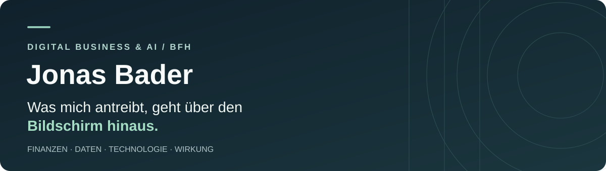

  

  <a href="https://jonasbader7.github.io/Portfoliopage/"><strong>Portfolio ansehen</strong></a>
  &nbsp;·&nbsp;
  <a href="https://jonasbader7.github.io/BORS/">BORS live ausprobieren</a>
  &nbsp;·&nbsp;
  <a href="https://github.com/Jonasbader7?tab=repositories">Alle Repositories</a>

---

### Hallo, ich bin Jonas 👋

Ich studiere **Digital Business & AI an der Berner Fachhochschule (BFH)** mit Schwerpunkt Datenanalyse. Zuvor habe ich eine Banklehre abgeschlossen, mehrere Jahre im Banking gearbeitet und Physik studiert.

Mich interessiert, wie sich **wirtschaftliches Verständnis, Daten und Technologie** verbinden lassen – für Projekte, die nicht nur auf dem Bildschirm funktionieren, sondern auch ausserhalb davon einen Nutzen haben können. Besonders wichtig sind mir Menschen, ein sinnvoller Ressourceneinsatz und nachhaltige Perspektiven.

### Ausgewählte Projekte

<table>
  <tr>
    <td width="50%" valign="top">
      <h3>🚒 <a href="https://github.com/Jonasbader7/BORS">BORS Bern</a></h3>
      
<strong>Geodaten &amp; Routing</strong>

      
Fahrzeugabhängiges Einsatzrouting für Bern: Welche Strassen sind für verschiedene Blaulichtfahrzeuge physisch passierbar?

      
Mein Beitrag: Product Owner und technische Umsetzung · Teamprojekt

      
<code>Python</code> <code>QGIS</code> <code>JavaScript</code> <code>MapLibre</code>

      <a href="https://jonasbader7.github.io/BORS/">Web-Demo ansehen</a>
      
Forschungsprototyp, nicht für reale Einsätze freigegeben.

    </td>
    <td width="50%" valign="top">
      <h3>📊 <a href="https://github.com/Jonasbader7/life-expectancy-analysis-r">Lebenserwartungsanalyse</a></h3>
      
<strong>Statistik &amp; Datenanalyse</strong>

      
Reproduzierbare Untersuchung statistischer Zusammenhänge mit Regressionsmodellen und Interaktionseffekten.

      
<code>R</code> <code>Regression</code> <code>Data Analysis</code>

      <a href="https://github.com/Jonasbader7/life-expectancy-analysis-r">Analyse ansehen</a>
    </td>
  </tr>
  <tr>
    <td valign="top">
      <h3>💸 <a href="https://github.com/Jonasbader7/SplitMate">SplitMate</a></h3>
      
<strong>Webentwicklung &amp; gemeinsame Ausgaben</strong>

      
Studienprototyp zur fairen Aufteilung gemeinsamer Ausgaben in Gruppen oder WGs.

      
Mein Beitrag: Schuldenberechnung im Backend · Teamprojekt

      
<code>Vue 3</code> <code>Strapi 5</code> <code>SQLite</code>

      <a href="https://github.com/Jonasbader7/SplitMate">Projekt ansehen</a>
    </td>
    <td valign="top">
      <h3>🎬 <a href="https://github.com/Jonasbader7/freddy-entrepreneurship-2024">Die Befreiung von Freddy</a></h3>
      
<strong>BFH Entrepreneurship Week 2024</strong>

      
Teamauszeichnung: <em>Jurypreis für Originalität und den produktiven Einsatz von Technologie.</em>

      
Mein Beitrag: vollständiger Videoschnitt und Nachbearbeitung in LumaFusion; teilweise Aufnahmen.

      
<code>LumaFusion</code> <code>Videoproduktion</code>

      <a href="https://github.com/Jonasbader7/freddy-entrepreneurship-2024">Projekt ansehen</a>
    </td>
  </tr>
</table>

### Weitere Arbeiten

- 🌐 **[Meine Portfolio-Webseite](https://github.com/Jonasbader7/Portfoliopage)** – selbst umgesetzt mit HTML, CSS und JavaScript; Deutsch, Englisch und Französisch.
- 🧩 **[BFH-Projektsammlung](https://github.com/Jonasbader7/bfh-digital-business-projects)** – Konzepte zu IT-Architektur, Requirements Engineering und Service Design.

### Mein Werkzeugkasten

**Daten & Analyse:** Python · R · SQL · QGIS · Excel  
**Entwicklung:** JavaScript · HTML/CSS · Git  
**Weitere Erfahrung:** Banking & Beratung · Requirements · Product Ownership · LumaFusion

---

  <strong>Neugierig geworden?</strong> 
  Auf meiner <a href="https://jonasbader7.github.io/Portfoliopage/">Portfolio-Webseite</a> erzähle ich mehr über meinen Weg, meine Motivation und die Projekte.

